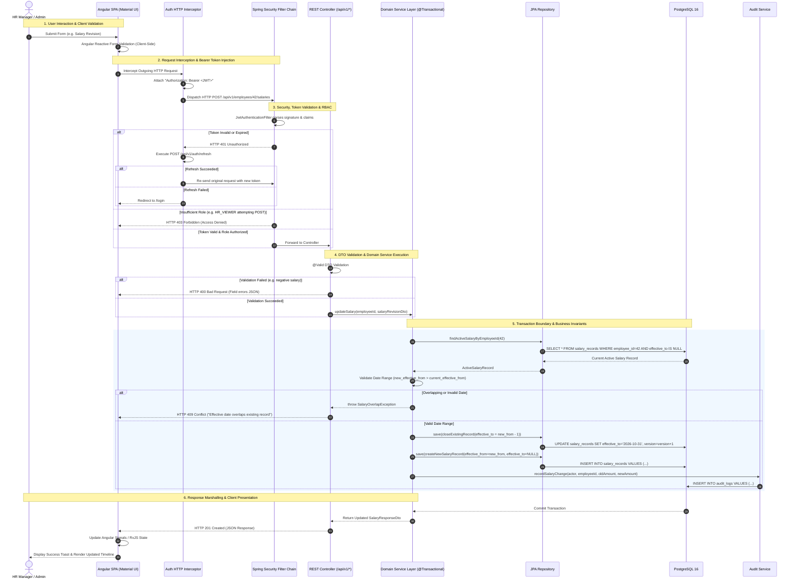

# System Flow Diagram (SFD) — ACME Employee Salary Management System

## 1. System Interaction Flow Overview

The diagram below details the end-to-end request lifecycle from the HR Manager's browser to the database persistence layer, illustrating authentication, authorization, transactional domain logic, audit trail generation, and error mitigation.

## 2. Key Process Flows

### 2.1 Authentication & Token Refresh Flow
1. **Login**: User submits username and password to `/api/v1/auth/login`. Authentication provider validates hashed password via BCrypt. If successful, generates an access token (15m expiry) and persists a hashed refresh token (7d expiry) in `refresh_tokens`.
2. **Silent Refresh**: When the access token expires, Angular's `AuthInterceptor` captures the `401 Unauthorized` response. It puts pending requests into a queue, calls `/api/v1/auth/refresh` with the refresh token, receives a new token pair, rotates the database refresh token, and replays all queued requests seamlessly.
3. **Logout**: Calling `/api/v1/auth/logout` explicitly deletes/revokes the refresh token record from PostgreSQL, preventing any subsequent silent re-authentication.

### 2.2 Salary Revision Workflow
- Enforces strict single-active-record invariant per employee.
- Checks that the new effective date is strictly after the prior record's start date.
- Supersedes the prior record by updating `effective_to` to `new_effective_from - 1 day`.
- Creates a new record with `effective_from` set and `effective_to = NULL`.
- Both operations and the audit record are executed within a single `@Transactional` method, guaranteeing atomicity.

### 2.3 Analytics & Reporting Flow
- Requests to `/api/v1/analytics/*` bypass individual entity retrieval.
- Repositories execute optimized SQL aggregation queries (`COUNT`, `AVG`, `MIN`, `MAX`, `GROUP BY department_id, currency`).
- Aggregations strictly partition by currency, preventing misleading mathematical blending across differing currencies.
- CSV exports stream results with formula-sanitizing transformation on all text fields.
